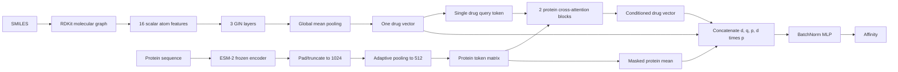
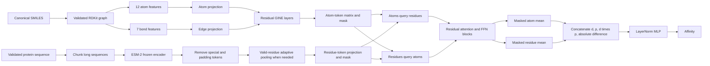
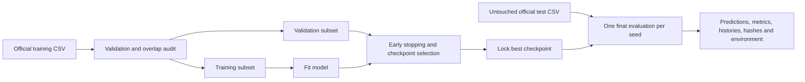

# HGTA architecture comparison

## Previous architecture

## Current journal-oriented architecture

## Evaluation architecture

## Direct comparison

| Dimension | Previous HGTA | Current HGTA | Consequence |
|---|---|---|---|
| Drug tokens at fusion | One pooled graph vector | Every atom | Current model can represent local atom--residue relationships |
| Molecular messages | Connectivity only | Bond-aware GINE | Bond order and chemical context affect message passing |
| Protein preparation | Pad to 1024, then pool | Remove padding/special tokens, chunk long sequences | Avoids padding contamination and silent truncation |
| Interaction | Drug-to-protein only | Bidirectional atom--residue co-attention | Both modalities condition each other |
| Normalization | BatchNorm | LayerNorm | Robust to small and final batches |
| Invalid SMILES | Silent zero graph | Hard data-quality error | Prevents hidden corrupted observations |
| Checkpoint criterion | Test MSE | Validation MSE | Removes checkpoint-selection leakage |
| Test usage | Repeated every 20 epochs | Once after model selection | Test remains an independent estimate |
| Repetitions | One seed | Five predefined seeds | Allows variability reporting |
| Audit trail | Aggregate JSON | Hashes, environment, histories, predictions and checkpoints | Supports reproducibility and paired statistics |

## Tensor flow

For hidden width `D=256`, batch size `B`, maximum atoms `A`, and maximum retained
residues `R`:

| Stage | Previous | Current |
|---|---:|---:|
| Drug representation before fusion | `[B, 1, 480]` after projection from one graph vector | `[B, A, 256]` |
| Protein representation | `[B, 512, 480]` | `[B, R, 256]`, `R <= 512` |
| Main attention map | `[B, 1, 512]` | Two maps: `[B, A, R]` and `[B, R, A]` |
| Fused predictor input | `[B, 1920]` | `[B, 1024]` |

The current architecture is more expressive but has attention complexity
`O(B*A*R*D)`. For unusually large ligands or proteins, pocket selection or sparse
top-k attention is the appropriate next optimization.
